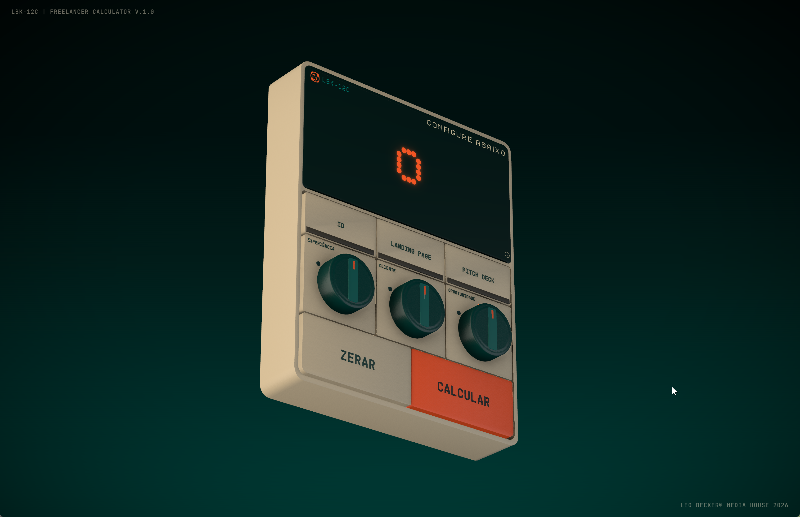

# LBK-12C, Freelancer Pricing Calculator



Uma ferramenta de precificação para designers freelancer, construída como um **dispositivo 3D fotorrealista que você opera de verdade**: gira os knobs, aperta os botões de serviço e vê o display dot-matrix rolar até o preço. Os valores são calibrados para o mercado de design brasileiro.

**No ar:** https://lbk-12c.leobecker.com

## O que faz

Escolha um serviço (**ID**, **Landing Page** ou **Pitch Deck**), ajuste o porte do cliente, o seu nível de senioridade e o quanto você quer o trabalho. O dispositivo calcula um preço calibrado ao mercado e ainda explica a metodologia por trás.

## Stack

- **Vite 6**, **React 18** e **TypeScript**
- **React Three Fiber** (three.js) para o dispositivo 3D, com `drei`, `postprocessing` e `react-spring`
- Modelo 3D feito no **Blender** e exportado como um único GLB (`public/models/lbk12c.glb`). A modelagem foi dirigida direto pelo Claude via [ahujasid/blender-mcp](https://github.com/ahujasid/blender-mcp), o servidor MCP que conecta o Blender ao assistente.
- **Tailwind CSS v4**
- Um **fallback 2D** em CSS puro entra automaticamente quando o WebGL não está disponível

## Rodar

```bash
pnpm install
pnpm dev        # http://localhost:5173
```

Adicione `?edit=1` na URL para abrir o editor de layout ao vivo (sliders, gizmos e orbit).

## Build

```bash
pnpm build      # saída estática em dist/
```

## Deploy

Containerizado com um **Dockerfile** multi-stage (build em Node, depois **nginx** servindo o bundle estático). Veja `Dockerfile` e `nginx.conf`. A integração do modelo GLB está documentada em `MODEL_INTEGRATION.md`.

© Leo Becker Media House
